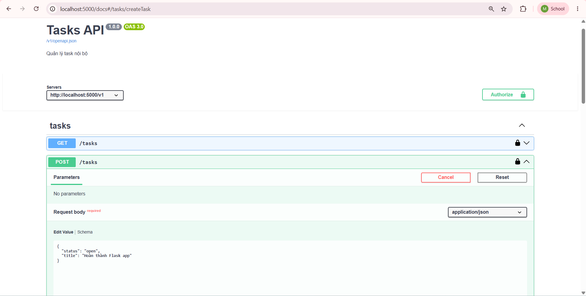
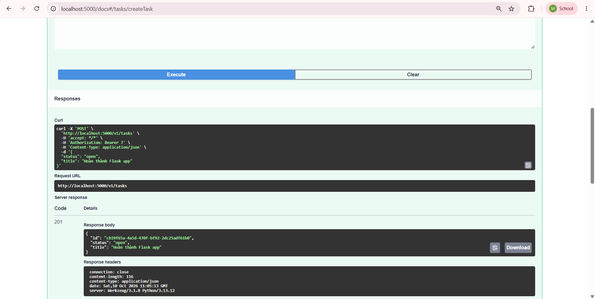
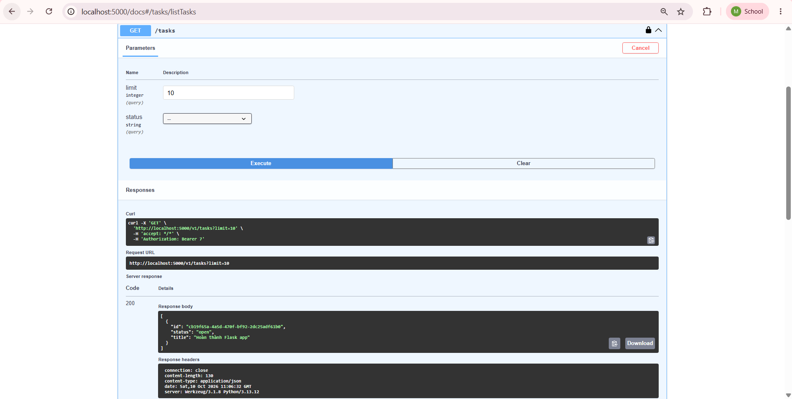

## Swagger UI tích hợp trong Flask app với "Try it out" hoạt động

  <em>Hình 1. Tạo 1 task mới bằng POST</em>

  <em>Hình 2. Tạo task mới thành công</em>

  <em>Hình 3. GET danh sách tasks có task vừa tạo</em>

## Mô tả 2 quyết định thiết kế khó nhất